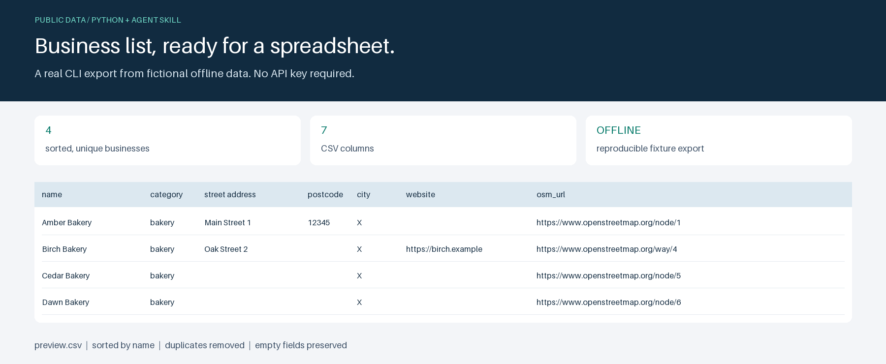

# Business list demo

Turn public OpenStreetMap businesses into a sorted, deduplicated CSV with a Python CLI and a Claude Agent Skill.

[](https://github.com/shawnrruss/demo-lead-skill/actions/workflows/ci.yml)



Original demo, public data only, not client work. AI-assisted implementation and documentation.

## What it shows

- A reusable agent skill backed by a standalone Python CLI.
- Explicit business-tag mappings and escaped Overpass queries.
- One bounded HTTP request with clear service errors and no hidden retries.
- Stable sorting, case-insensitive deduplication, and spreadsheet-ready CSV output.
- 13 offline tests covering export, validation, HTTP failures, and the skill contract.

Supported types: bakery, cafe, dentist, hairdresser, bicycle shop, restaurant, florist. The JSON mapping is in `leadlist/tags.json`.

## Quick start

From this repository with Python 3.12+:

```sh
python -m venv .venv
# Activate: source .venv/bin/activate (Windows PowerShell: .venv/Scripts/Activate.ps1)
python -m pip install -r requirements.lock
python -m pip install --no-deps --no-build-isolation -e .
python -m leadlist --city "Tampere" --type bakery --out out/bakeries.csv --limit 50
```

The default limit is 50 sorted, deduplicated rows; use a positive integer to change it. Quote multiword types, for example `--type "bicycle shop"`.

## Offline demonstration

The fixture contains six made-up elements, including a duplicate and an unnamed place. This command writes four business rows and a header without network access:

```sh
python -m leadlist --city X --type bakery --offline tests/fixtures/overpass_sample.json --out out/t.csv
```

## Tests and quality checks

```sh
python -m unittest tests.test_offline
python -m ruff check .
python -m build --no-isolation
python docs/render_preview.py
test -f docs/preview.png -o -f docs/preview.gif
```

Tests mock HTTP calls; no live API access is needed. CI runs the same checks on Python 3.12 with locked dependencies. No separate typecheck command is configured.

The preview command runs the CLI against the made-up fixture, then uses Pillow to render the resulting CSV to `docs/preview.png`. It needs no browser, network, or external fonts.

## Project layout

| Path | Purpose |
| --- | --- |
| `leadlist/` | CLI, query client, tag mapping, and CSV exporter |
| `skills/business-list/` | Claude Agent Skill instructions |
| `tests/test_offline.py` | Offline regression tests |
| `tests/fixtures/` | Six made-up Overpass elements |
| `docs/render_preview.py` | Reproducible CSV preview renderer |
| `requirements.lock` | Pinned runtime, lint, build, and preview dependencies |
| `.github/workflows/ci.yml` | Tests, lint, build, and preview checks |

## Install the Claude skill

Copy `skills/business-list` into your Claude skills directory (for Claude Code, `~/.claude/skills/business-list`). Install the Python helper as above and run it from this repository. Ask Claude for a CSV of businesses by city and type; the skill asks for missing inputs, runs the helper, summarizes results, and offers the CSV.

## Data and limitations

Data (c) OpenStreetMap contributors, ODbL

Source: [OpenStreetMap](https://www.openstreetmap.org/copyright), queried through the public [Overpass API](https://overpass-api.de/). Preserve this attribution when sharing the data; ODbL terms apply to OSM-derived data.

Each live run sends one POST request with a demo User-Agent, a 35-second client timeout and a 25-second query timeout. There are no automatic retries or redirects. HTTP and service errors produce a clear error and nonzero exit status.

City lookup uses exact administrative-area names. Ambiguous names may combine multiple areas; names must match OSM spelling, and places without matching areas return no rows. Coverage may be incomplete or outdated. The limit applies after retrieval, sorting and deduplication, so it does not bound query size.

Columns: name, category, street address, postcode, city, website, osm_url. Unnamed places are skipped; name plus street address determines duplicates (case-insensitive). Missing address fields stay empty; city falls back to the requested city. Website URLs are copied from OSM tags without fetching them. The helper exports no email or phone fields and does not scrape websites. Review data before business use.

Generated `out/`, logs, virtual environments and build metadata are ignored by git.
